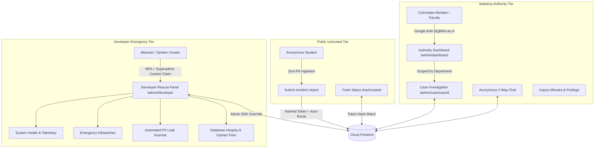
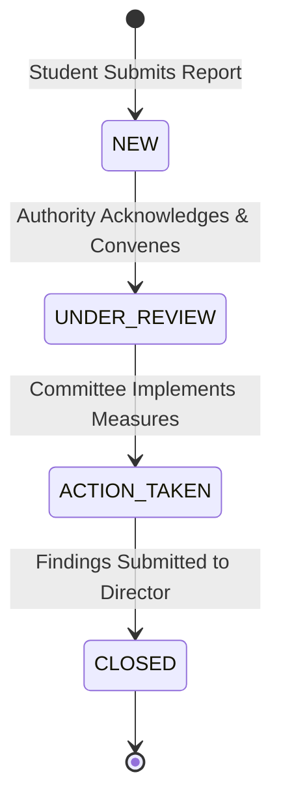

# SafeConnect: Committee Authority Dashboard & Developer Emergency Panel
## Comprehensive Architecture Blueprint, Implementation Guide, and Operations Manual

> **Document Version**: 1.0.0  
> **Target Audience**: GLBITM Committee Authorities, System Administrators, and Core Developer/Creator  
> **Compliance Standard**: AICTE Regulations 2016 (Gender Sensitization, Prevention and Prohibition of Sexual Harassment) & GLBITM Approved BOG Grievance Policy (20th BOG Meeting, Item 20.8)

---

## 📑 Table of Contents

1. [Executive Summary & Dual-System Architecture](#1-executive-summary--dual-system-architecture)
2. [Authority & Committee Dashboard Specification](#2-authority--committee-dashboard-specification)
   - [2.1 Departmental Scoping & Access Model](#21-departmental-scoping--access-model)
   - [2.2 Core Features & Statutory Timelines](#22-core-features--statutory-timelines)
   - [2.3 Case Lifecycle & Quorum Enforcement](#23-case-lifecycle--quorum-enforcement)
   - [2.4 Two-Way Anonymous Communication Protocol](#24-two-way-anonymous-communication-protocol)
3. [Developer & Creator Emergency Panel ("God-Mode / Break-Glass")](#3-developer--creator-emergency-panel-god-mode--break-glass)
   - [3.1 Purpose & Security Perimeter](#31-purpose--security-perimeter)
   - [3.2 System Health & Live Telemetry](#32-system-health--live-telemetry)
   - [3.3 Emergency Break-Glass & Maintenance Controls](#33-emergency-break-glass--maintenance-controls)
   - [3.4 Database Integrity, Self-Healing & Orphan Cleanup](#34-database-integrity-self-healing--orphan-cleanup)
   - [3.5 Zero-PII Leak Scanner & Redaction Tool](#35-zero-pii-leak-scanner--redaction-tool)
   - [3.6 Tamper-Evident Audit Log Explorer](#36-tamper-evident-audit-log-explorer)
   - [3.7 Authority Identity & Permission Provisioning](#37-authority-identity--permission-provisioning)
4. [Step-by-Step Build & Implementation Blueprint](#4-step-by-step-build--implementation-blueprint)
   - [4.1 Database Schema Extensions](#41-database-schema-extensions)
   - [4.2 Firestore Security Rules (Multi-Tier RBAC)](#42-firestore-security-rules-multi-tier-rbac)
   - [4.3 Authentication, Custom Claims & Edge Middleware](#43-authentication-custom-claims--edge-middleware)
   - [4.4 File Structure of Components & API Routes](#44-file-structure-of-components--api-routes)
   - [4.5 Core Implementation Code Samples](#45-core-implementation-code-samples)
5. [User Guide Part A: Committee Members & Authorities](#5-user-guide-part-a-committee-members--authorities)
   - [5.1 Login & Security Verification](#51-login--security-verification)
   - [5.2 Navigating Cases & Prioritization](#52-navigating-cases--prioritization)
   - [5.3 Communicating with Anonymous Students](#53-communicating-with-anonymous-students)
   - [5.4 Convening Quorum & Recording Internal Notes](#54-convening-quorum--recording-internal-notes)
   - [5.5 Case Resolution & Statutory PDF Export](#55-case-resolution--statutory-pdf-export)
6. [User Guide Part B: Developer & Creator Emergency Playbook](#6-user-guide-part-b-developer--creator-emergency-playbook)
   - [6.1 Accessing the Developer Rescue Panel](#61-accessing-the-developer-rescue-panel)
   - [6.2 Emergency Scenario 1: DDoS / Spam Attack](#62-emergency-scenario-1-ddos--spam-attack)
   - [6.3 Emergency Scenario 2: Accidental Student Identity Leak](#63-emergency-scenario-2-accidental-student-identity-leak)
   - [6.4 Emergency Scenario 3: Unrouted / Stalled Grievance](#64-emergency-scenario-3-unrouted--stalled-grievance)
   - [6.5 Emergency Scenario 4: Firebase Connection / Service Account Failure](#65-emergency-scenario-4-firebase-connection--service-account-failure)
   - [6.6 Emergency Scenario 5: Authority Access Revocation](#66-emergency-scenario-5-authority-access-revocation)
   - [6.7 Disaster Recovery Checklist](#67-disaster-recovery-checklist)

---

## 1. Executive Summary & Dual-System Architecture

SafeConnect serves two fundamentally distinct operational groups with radically different trust profiles:



### Key Differences Between the Panels

| Dimension | Committee Authority Dashboard | Developer / Creator Emergency Panel |
| :--- | :--- | :--- |
| **Primary Route** | `/admin/dashboard` & `/admin/case/[caseId]` | `/admin/developer` (or `/admin/system`) |
| **Target User** | Presiding Officer, Wardens, Faculty Members | Core Developer / Creator (Altamish) |
| **Access Control** | Verified `@glbitm.ac.in` Email + `authority` Role | Superadmin Custom Claim + Developer UID Match |
| **Data Scope** | Department-filtered (IC sees IC, Warden sees Warden) | Global tenant-wide visibility across all collections |
| **Case Actions** | Change status, chat, log minutes, assign severity | Force-reroute, repair corrupt hashes, purge mock data |
| **System Actions** | View assigned cases, export compliance PDFs | Toggle maintenance mode, inspect health, check leaks |
| **Audit Requirement**| Every view and status change logged | Every emergency override logged with tamper-evident hash |

---

## 2. Authority & Committee Dashboard Specification

The Committee Authority Dashboard is the daily operational workspace for GLBITM statutory bodies.

### 2.1 Departmental Scoping & Access Model

Authorities only have access to cases routed to their department to preserve confidentiality across administrative boundaries:

```typescript
// Department to Committee mapping
export const DEPARTMENT_SCOPING = {
  INTERNAL_COMMITTEE: ['SEXUAL_HARASSMENT'],
  ANTI_RAGGING_CELL: ['RAGGING'],
  DISCIPLINE_COMMITTEE: ['BULLYING', 'STALKING', 'CYBERBULLYING'],
  WARDEN: ['HOSTEL_ISSUE'],
  PR_CELL: ['OTHER'],
} as const;
```

- **Internal Committee (IC)**: Handles POSH and sexual harassment incidents under AICTE 2016 regulations. Members include Dr. Rashmi Mishra (Presiding Officer), faculty, student reps, and external NGO rep (Ms. Aayesha Khan).
- **Anti-Ragging Committee**: Handles ragging incidents under UGC Anti-Ragging regulations.
- **Discipline Committee**: Handles cyberbullying, physical bullying, and general stalking.
- **Hostel Warden**: Handles residential hostel incidents, maintenance harassment, curfew issues.
- **PR / General Cell**: Handles uncategorized grievances.

### 2.2 Core Features & Statutory Timelines

1. **Urgency & Statutory SLA Countdown**:
   - **AICTE 7-Day Meeting Mandate**: Displays a countdown timer badge (`Alert: Meeting must convene within X days`) from the moment a `NEW` case is logged.
   - **14-Day Formal Recommendation Mandate**: Tracks the statutory 14-day window for the committee to submit findings to the Director.
2. **Case Triage Grid**:
   - Filter by: `All`, `New`, `Under Review`, `Action Taken`, `Closed`.
   - Priority sorting: High severity and impending statutory SLA deadlines float to top.
   - Live search by Case ID (e.g. `SC-7A3F9`).
3. **Investigation & Evidence Inspection**:
   - View incident description, incident timestamp, campus location (e.g. "Mechanical Block Room 204", "Girls Hostel 2").
   - Clickable thumbnail gallery for photographic/screenshot evidence.
4. **Severity Matrix**:
   - Ability to classify or reclassify severity: `LOW` (informal warning / advisory), `MEDIUM` (investigation warranted), `HIGH` (immediate protective measures required).

### 2.3 Case Lifecycle & Quorum Enforcement



#### Quorum Verification Engine (GLBITM Grievance Policy §1.2.6)
For a grievance hearing or resolution to be legally binding, a **minimum of 3 members** must be in attendance. In the Case Detail page, authorities check off the attending members. The system will prevent marking a case as `ACTION_TAKEN` or `CLOSED` unless the quorum validator confirms `≥ 3` members.

### 2.4 Two-Way Anonymous Communication Protocol

Authorities can communicate directly with the reporting student without breaking anonymity:
- Authorities see: `Student (Anonymous)`
- Student sees: `GLBITM Committee Authority` (or department name)
- The messaging UI prevents authorities from asking for student names, roll numbers, or identity disclosures. Built-in pre-written inquiry templates ensure trauma-informed phrasing:
  - *Template 1 (Clarification)*: "Thank you for reaching out. To assist our inquiry, could you share whether this occurred during daytime classes or evening hours?"
  - *Template 2 (Support Resources)*: "The committee is reviewing your case. Please know that campus counseling services are available at Student Support Cell, Room 102."
  - *Template 3 (Protective Action)*: "Preliminary security measures have been deployed in the reported area. We will keep you updated on further findings."

---

## 3. Developer & Creator Emergency Panel ("God-Mode / Break-Glass")

The Developer Emergency Panel (`/admin/developer`) is built specifically for **Altamish** (lead developer/creator) to diagnose, repair, and maintain the system if unexpected conditions occur in production.

### 3.1 Purpose & Security Perimeter

> [!CAUTION]
> The Developer Panel has the power to manipulate raw database states, override status locks, trigger system-wide maintenance mode, and purge corrupt entries. It MUST be protected behind two-factor authentication and strict IP/UID validation.

- **URL**: `/admin/developer`
- **Access Rule**:
  - `request.auth != null`
  - User email matches creator email (`mohdaltamish...` or authorized developer list)
  - Custom Claim `role === 'superadmin'`
- **Tamper-Evident Session Log**: Every visit and action inside the Developer Panel generates an immutable record in `auditLogs`.

### 3.2 System Health & Live Telemetry

A high-density diagnostic dashboard displaying:
1. **Database Latency**: Round-trip latency test to Firestore (`ping` collection).
2. **Firebase Storage Connectivity**: Health of evidence file storage bucket.
3. **Cloud Functions Status**: Trigger queue health and execution success rates.
4. **Active Session Counts**: Number of authorities logged in over the last hour.
5. **Environment Configuration Audit**: Real-time validation confirming that all required `.env.local` variables (`TOKEN_HASH_SECRET`, `FIREBASE_ADMIN_PRIVATE_KEY`, etc.) are loaded and syntactically valid.

### 3.3 Emergency Break-Glass & Maintenance Controls

When unexpected issues occur (e.g. coordinated spam attack, database migration, external audit):

1. **Maintenance Mode Switch**:
   - Immediately diverts all public routes (`/report`, `/track`) to an informative holding screen: *"SafeConnect is currently undergoing scheduled institutional maintenance. For urgent campus emergencies, contact NCW Helpline: 7827170170 or Security Control: 112."*
   - Authority and Developer routes remain accessible.
2. **Submission Rate Limiter / Flood Gate**:
   - Caps report submissions per minute to prevent malicious database exhaustion.
3. **Read-Only Lock**:
   - Temporarily freezes writes to `reports` and `messages` while keeping historical cases viewable for scheduled hearings.

### 3.4 Database Integrity, Self-Healing & Orphan Cleanup

Automated self-healing scripts that can be triggered with one click:
- **Scan for Unrouted Cases**: Finds any report where `routedTo` is null or invalid, and reroutes it using `routeReport()`.
- **Orphan Message Pruner**: Scans `reports/{id}/messages` and detects messages pointing to deleted or non-existent parent reports.
- **Corrupt Token Hash Detector**: Validates that all `accessTokenHash` fields follow the 64-character SHA-256 hex format.
- **Stale Case Watchdog**: Identifies cases in `NEW` state for longer than 5 days and sends high-priority dispatch alerts to the assigned committee head.
- **Staging Seed & Purge**: Generates 5 realistic, mock test cases with simulated chat history for committee training sessions, and purges them with a single click without touching production cases.

### 3.5 Zero-PII Leak Scanner & Redaction Tool

Because anonymous reporters or authorities might accidentally type names, phone numbers, or roll numbers into descriptions or chat messages:

```mermaid
flowchart LR
    A[Raw Report or Chat Message] --> B[PII Scanner Engine]
    B --> C{Detects PII Pattern?}
    C -->|Yes: 10-digit Phone| D[Flag in Developer Console]
    C -->|Yes: 13-digit AKTU Roll No.| D
    C -->|Yes: Email address| D
    C -->|No| E[Pass: Privacy Verified]
    D --> F[Developer One-Click Redact: Replace with [REDACTED]]
```

The scanner runs periodically or on-demand:
- Regex for Indian Mobile Numbers: `/\b[6-9]\d{9}\b/`
- Regex for GLBITM/AKTU Roll Numbers: `/\b2[0-9]{12}\b/`
- Regex for Email Addresses: `/[a-zA-Z0-9._%+-]+@[a-zA-Z0-9.-]+\.[a-zA-Z]{2,}/`
- Masking action: Replaces detected string with `[CONFIDENTIAL PII REDACTED PER PRIVACY RULE §1]`.

### 3.6 Tamper-Evident Audit Log Explorer

A searchable, filterable log viewer showing:
- `timestamp`: ISO 8601 formatted event time.
- `performedBy`: Authority UID or Developer UID.
- `action`: E.g. `VIEW_CASE`, `UPDATE_STATUS`, `SEND_MESSAGE`, `TOGGLE_MAINTENANCE`, `REDACT_PII`.
- `caseId`: The associated grievance case.
- `ipHash`: SHA-256 hash of the request origin (no plain IP stored).

### 3.7 Authority Identity & Permission Provisioning

Manage committee credentials without accessing Firebase Console:
- **Invite Authority**: Enter official college email (e.g. `rashmi.mishra@glbitm.ac.in`), select Department (`INTERNAL_COMMITTEE`), and set role (`authority`).
- **Deactivate Authority**: Instantly toggle `active: false`, revoking their dashboard access upon resignation or semester transition.
- **Role Elevation**: Elevate a senior member to `superadmin` or revert to `authority`.

---

## 4. Step-by-Step Build & Implementation Blueprint

### 4.1 Database Schema Extensions

To support committee notes, quorum validation, and system controls, we extend the Firestore schema defined in `types/index.ts`:

```typescript
// Add to types/index.ts

// ── Internal Committee Note ──────────────────────────────────────────
export interface CommitteeNote {
  id: string;
  authorUid: string;
  authorName: string;
  department: Department;
  noteText: string;
  isFormalMinute: boolean;
  createdAt: string;
}

// ── Case Resolution Report ───────────────────────────────────────────
export interface CaseResolution {
  resolvedByUid: string;
  actionSummary: string;
  quorumMembers: string[]; // UIDs of at least 3 attending members
  statutoryOutcome: 'SUBMITTED_TO_DIRECTOR' | 'DISMISSED_NO_FOUNDATION' | 'MUTUAL_RESOLUTION' | 'POLICE_ESCALATION';
  resolvedAt: string;
  sanitizedPdfUrl?: string;
}

// ── System Configuration Document (single document at system/config) ──
export interface SystemConfig {
  maintenanceMode: boolean;
  maintenanceMessage: string;
  rateLimitPerMinute: number;
  readOnlyMode: boolean;
  alertBanner?: {
    enabled: boolean;
    text: string;
    level: 'info' | 'warning' | 'urgent';
  };
  lastHealthCheck: string;
}
```

### 4.2 Firestore Security Rules (Multi-Tier RBAC)

Update [firestore.rules](file:///Users/mohdaltamish/Developer/SafeConnect/safeconnect/firestore.rules) to enforce department scoping and developer superadmin access:

```javascript
rules_version = '2';
service cloud.firestore {
  match /databases/{database}/documents {

    // Helper functions
    function isAuthenticated() {
      return request.auth != null;
    }
    
    function isSuperadmin() {
      return isAuthenticated() &&
        exists(/databases/$(database)/documents/authorities/$(request.auth.uid)) &&
        get(/databases/$(database)/documents/authorities/$(request.auth.uid)).data.role == 'superadmin';
    }

    function isAuthority() {
      return isAuthenticated() &&
        exists(/databases/$(database)/documents/authorities/$(request.auth.uid)) &&
        get(/databases/$(database)/documents/authorities/$(request.auth.uid)).data.active == true;
    }

    function getAuthorityDept() {
      return get(/databases/$(database)/documents/authorities/$(request.auth.uid)).data.department;
    }

    // ── Reports Collection ──
    match /reports/{reportId} {
      // Students access ONLY via Next.js Route Handlers (Admin SDK bypasses rules).
      // Direct client SDK read is allowed for authorities matching their department, or superadmin:
      allow read: if isSuperadmin() || (isAuthority() && resource.data.routedTo == getAuthorityDept());
      allow update: if isSuperadmin() || (isAuthority() && resource.data.routedTo == getAuthorityDept());
      allow create, delete: if isSuperadmin();

      // ── Messages Subcollection ──
      match /messages/{messageId} {
        allow read: if isSuperadmin() || (isAuthority() && get(/databases/$(database)/documents/reports/$(reportId)).data.routedTo == getAuthorityDept());
        allow create: if isSuperadmin() || (isAuthority() && get(/databases/$(database)/documents/reports/$(reportId)).data.routedTo == getAuthorityDept());
        allow update, delete: if isSuperadmin();
      }

      // ── Notes Subcollection (Internal to Authorities) ──
      match /notes/{noteId} {
        allow read, create: if isSuperadmin() || (isAuthority() && get(/databases/$(database)/documents/reports/$(reportId)).data.routedTo == getAuthorityDept());
        allow update, delete: if isSuperadmin();
      }
    }

    // ── Authorities Collection ──
    match /authorities/{uid} {
      allow read: if isAuthenticated() && (request.auth.uid == uid || isSuperadmin());
      allow write: if isSuperadmin();
    }

    // ── System Configuration ──
    match /system/{document=**} {
      allow read: if isAuthenticated();
      allow write: if isSuperadmin();
    }

    // ── Audit Logs ──
    match /auditLogs/{logId} {
      allow read: if isSuperadmin() || isAuthority();
      allow write: if false; // Only written via Admin SDK
    }
  }
}
```

### 4.3 Authentication, Custom Claims & Edge Middleware

Create an Edge Middleware file (`middleware.ts`) at the project root to intercept `/admin/*` requests:

```typescript
// middleware.ts
import { NextResponse } from 'next/server';
import type { NextRequest } from 'next/server';

export function middleware(request: NextRequest) {
  const { pathname } = request.nextUrl;

  // Only guard /admin routes
  if (pathname.startsWith('/admin')) {
    // Exclude the login page itself
    if (pathname === '/admin/login') {
      return NextResponse.next();
    }

    // Check for session cookie
    const sessionCookie = request.cookies.get('__session')?.value;
    if (!sessionCookie) {
      const loginUrl = new URL('/admin/login', request.url);
      loginUrl.searchParams.set('redirect', pathname);
      return NextResponse.redirect(loginUrl);
    }

    // Developer route protection
    if (pathname.startsWith('/admin/developer')) {
      const devClaim = request.cookies.get('__dev_verified')?.value;
      if (devClaim !== 'true') {
        return NextResponse.redirect(new URL('/admin/dashboard', request.url));
      }
    }
  }

  return NextResponse.next();
}

export const config = {
  matcher: ['/admin/:path*'],
};
```

### 4.4 File Structure of Components & API Routes

Here is the exact file architecture to implement both dashboards:

```
safeconnect/
├── app/
│   ├── admin/
│   │   ├── layout.tsx                 # [NEW] Common admin layout with nav & auth session context
│   │   ├── login/
│   │   │   └── page.tsx               # [UPDATE] Full Firebase Auth with @glbitm.ac.in domain check
│   │   ├── dashboard/
│   │   │   └── page.tsx               # [UPDATE] Authority Case Table with filter, sort & SLA alert
│   │   ├── case/
│   │   │   └── [caseId]/
│   │   │       └── page.tsx           # [UPDATE] Complete Case Investigation & Chat Workspace
│   │   ├── developer/
│   │   │   └── page.tsx               # [NEW] Emergency "God-Mode" Rescue & Health Panel
│   │   └── analytics/
│   │       └── page.tsx               # [UPDATE] Aggregated Zero-PII Committee Metrics
│   └── api/
│       └── admin/
│           ├── auth/
│           │   ├── session/route.ts   # [NEW] Exchange Firebase ID Token for secure HTTP-only Cookie
│           │   └── logout/route.ts    # [NEW] Clear admin session cookies
│           ├── cases/
│           │   ├── route.ts           # [NEW] List cases filtered by authority department
│           │   └── [caseId]/
│           │       ├── route.ts       # [NEW] Get single case with evidence & metadata
│           │       ├── status/route.ts# [NEW] Update status + record audit log
│           │       └── notes/route.ts # [NEW] Post/Get internal committee investigation notes
│           └── developer/
│               ├── health/route.ts    # [NEW] Run live system diagnostics
│               ├── maintenance/route.ts# [NEW] Toggle maintenance mode switch
│               ├── pii-scan/route.ts  # [NEW] Scan database for identity leaks
│               ├── repair/route.ts    # [NEW] Fix unrouted cases or broken hashes
│               └── users/route.ts     # [NEW] Provision or revoke authority accounts
├── components/
│   └── admin/
│       ├── AdminHeader.tsx            # [NEW] Top bar with user profile, role badge & logout
│       ├── CaseTable.tsx              # [UPDATE] Rich interactive table with SLA countdown
│       ├── CaseDetailPanel.tsx        # [UPDATE] Complete investigation workspace
│       ├── StatusDropdown.tsx         # [UPDATE] Status transition selector with confirmation
│       ├── QuorumValidator.tsx        # [NEW] 3-member minimum attendance checklist
│       ├── AuthorityChat.tsx          # [NEW] 2-way anonymous chat with canned templates
│       ├── CommitteeNotes.tsx         # [NEW] Internal minutes of meeting logger
│       └── developer/
│           ├── SystemHealthCard.tsx   # [NEW] Latency and connectivity metrics
│           ├── KillswitchPanel.tsx    # [NEW] Maintenance mode & rate limiting controls
│           ├── PIIScannerWidget.tsx   # [NEW] Real-time leak detection & redaction table
│           ├── DatabaseRepairTool.tsx # [NEW] Integrity checker and orphan fixer
│           └── UserManagementModal.tsx# [NEW] Add/remove faculty authorities
└── lib/
    └── admin/
        ├── session.ts                 # [NEW] Cookie session validation helper
        ├── audit.ts                   # [NEW] Audit log recorder utility
        └── diagnostics.ts             # [NEW] Firebase health ping & leak detection logic
```

### 4.5 Core Implementation Code Samples

#### A. Centralized Audit Log Helper (`lib/admin/audit.ts`)
```typescript
import { getAdminDb } from '@/lib/firebase/admin';

export async function recordAuditLog({
  action,
  performedByUid,
  reportId,
  details,
}: {
  action: string;
  performedByUid: string;
  reportId: string;
  details?: Record<string, unknown>;
}) {
  try {
    const db = getAdminDb();
    await db.collection('auditLogs').add({
      action,
      performedByUid,
      reportId,
      details: details || {},
      timestamp: new Date().toISOString(),
    });
  } catch (err) {
    console.error('[SafeConnect Audit] Failed to record audit log:', err);
  }
}
```

#### B. Developer Health & Diagnostic Route (`app/api/admin/developer/health/route.ts`)
```typescript
import { NextResponse } from 'next/server';
import { getAdminDb } from '@/lib/firebase/admin';

export const dynamic = 'force-dynamic';

export async function GET() {
  const startTime = Date.now();
  const checks: Record<string, { status: 'healthy' | 'unhealthy'; latencyMs?: number; error?: string }> = {};

  // 1. Check Firestore Read/Write
  try {
    const db = getAdminDb();
    const pingStart = Date.now();
    await db.collection('_health').doc('ping').set({ lastPing: new Date().toISOString() });
    checks.firestore = { status: 'healthy', latencyMs: Date.now() - pingStart };
  } catch (err) {
    checks.firestore = { status: 'unhealthy', error: err instanceof Error ? err.message : 'Unknown' };
  }

  // 2. Check Environment Variables
  const requiredEnvVars = [
    'NEXT_PUBLIC_FIREBASE_PROJECT_ID',
    'FIREBASE_ADMIN_PROJECT_ID',
    'FIREBASE_ADMIN_CLIENT_EMAIL',
    'FIREBASE_ADMIN_PRIVATE_KEY',
    'TOKEN_HASH_SECRET',
  ];
  const missingEnv = requiredEnvVars.filter((v) => !process.env[v]);
  checks.environment = {
    status: missingEnv.length === 0 ? 'healthy' : 'unhealthy',
    error: missingEnv.length > 0 ? `Missing: ${missingEnv.join(', ')}` : undefined,
  };

  // 3. Check Case Integrity (Unrouted Cases)
  try {
    const db = getAdminDb();
    const unroutedSnap = await db.collection('reports').where('routedTo', '==', null).limit(10).get();
    checks.unroutedCases = {
      status: unroutedSnap.empty ? 'healthy' : 'unhealthy',
      error: unroutedSnap.empty ? undefined : `${unroutedSnap.size} unrouted cases detected!`,
    };
  } catch (err) {
    checks.unroutedCases = { status: 'unhealthy', error: err instanceof Error ? err.message : 'Query failed' };
  }

  const allHealthy = Object.values(checks).every((c) => c.status === 'healthy');

  return NextResponse.json({
    systemStatus: allHealthy ? 'OPERATIONAL' : 'DEGRADED',
    timestamp: new Date().toISOString(),
    totalLatencyMs: Date.now() - startTime,
    checks,
  });
}
```

#### C. Automated PII Redaction Route (`app/api/admin/developer/pii-scan/route.ts`)
```typescript
import { NextRequest, NextResponse } from 'next/server';
import { getAdminDb } from '@/lib/firebase/admin';

export const dynamic = 'force-dynamic';

const PHONE_REGEX = /\b[6-9]\d{9}\b/g;
const ROLL_REGEX = /\b2[0-9]{12}\b/g;
const EMAIL_REGEX = /[a-zA-Z0-9._%+-]+@[a-zA-Z0-9.-]+\.[a-zA-Z]{2,}/g;

export async function GET() {
  const db = getAdminDb();
  const reportsSnap = await db.collection('reports').orderBy('createdAt', 'desc').limit(50).get();
  const flaggedItems: Array<{ id: string; caseId: string; type: string; snippet: string }> = [];

  for (const doc of reportsSnap.docs) {
    const data = doc.data();
    const desc = data.description || '';
    
    if (PHONE_REGEX.test(desc) || ROLL_REGEX.test(desc) || EMAIL_REGEX.test(desc)) {
      flaggedItems.push({
        id: doc.id,
        caseId: data.caseId,
        type: 'REPORT_DESCRIPTION',
        snippet: desc.substring(0, 100) + '...',
      });
    }
  }

  return NextResponse.json({ flaggedCount: flaggedItems.length, flaggedItems });
}

export async function POST(request: NextRequest) {
  const { docId } = await request.json();
  const db = getAdminDb();
  const docRef = db.collection('reports').doc(docId);
  const snap = await docRef.get();

  if (!snap.exists) {
    return NextResponse.json({ error: 'Report not found' }, { status: 404 });
  }

  let desc = snap.data()?.description || '';
  desc = desc.replace(PHONE_REGEX, '[PHONE REDACTED]');
  desc = desc.replace(ROLL_REGEX, '[ROLL NO REDACTED]');
  desc = desc.replace(EMAIL_REGEX, '[EMAIL REDACTED]');

  await docRef.update({
    description: desc,
    updatedAt: new Date().toISOString(),
    piiSanitized: true,
  });

  return NextResponse.json({ success: true, message: 'PII successfully redacted.' });
}
```

---

## 5. User Guide Part A: Committee Members & Authorities

This section provides clear, step-by-step instructions for members of the **Internal Committee (IC)**, **Anti-Ragging Committee**, **Discipline Committee**, and **Hostel Wardens**.

### 5.1 Login & Security Verification

1. Open browser and navigate to: `https://safeconnect.glbitm.ac.in/admin/login`
2. Click **"Sign in with College Email"**.
3. Select your official institutional email account ending in `@glbitm.ac.in`.
4. If this is your first time logging in:
   - Your account must already be whitelisted by the presiding officer or system administrator.
   - If you see `Access Denied: Unregistered Authority`, contact [`wgc@glbitm.ac.in`](mailto:wgc@glbitm.ac.in) or the administrator to provision your account.
5. Upon successful authentication, you will be redirected to `/admin/dashboard`.

### 5.2 Navigating Cases & Prioritization

The dashboard displays cases assigned strictly to your committee:

```
+-----------------------------------------------------------------------------------------+
| SafeConnect Authority Workspace                         [Dr. Rashmi Mishra | IC Head] [Logout] |
+-----------------------------------------------------------------------------------------+
| [Overview]  [All Cases (14)]  [New (3)]  [Under Review (5)]  [Action Taken (4)]  [Closed (2)]   |
+-----------------------------------------------------------------------------------------+
| STATUTORY COMPLIANCE ALERT:                                                             |
| Case SC-4B8D1 received 4 days ago. 3 days remaining to convene statutory quorum!       |
+-----------------------------------------------------------------------------------------+
| Case ID   | Category           | Severity | Submitted   | Statutory SLA     | Action   |
|-----------|--------------------|----------|-------------|-------------------|----------|
| SC-8F2A1  | Sexual Harassment  | HIGH     | 2 hours ago | 7 Days to Constr. | [Review] |
| SC-4B8D1  | Stalking (Campus)  | MEDIUM   | 4 days ago  | 3 Days Remaining  | [Review] |
| SC-1M9K7  | Hostel Ragging     | HIGH     | 1 day ago   | 6 Days Remaining  | [Review] |
+-----------------------------------------------------------------------------------------+
```

1. **Check SLA Warnings First**: Look for any orange or red badges indicating cases nearing the 7-day meeting deadline.
2. **Review High Severity Items**: Immediate intervention may be needed if safety is compromised.
3. Click **[Review Case]** to open the detailed investigation view.

### 5.3 Communicating with Anonymous Students

1. Scroll down to the **"Two-Way Confidential Chat"** section.
2. Read any existing messages from the student.
3. To ask for clarification without compromising privacy:
   - Use the pre-built **Canned Templates** dropdown (e.g. *Request time clarification*, *Offer counseling support*).
   - Or type a custom response. **NEVER ask for the student's name, roll number, or phone number.**
4. Click **Send Response**. The student will see your reply next time they visit `/track` with their Case ID and Access Token.

### 5.4 Convening Quorum & Recording Internal Notes

1. In the **Quorum & Committee Attendance** box:
   - Check off the names of all attending committee members (e.g., Presiding Officer + 2 Faculty Members).
   - Ensure **at least 3 checkmarks** are active to satisfy GLBITM BOG Policy §1.2.6.
2. In the **Confidential Minutes & Findings** box:
   - Record the summary of committee deliberations.
   - Note down protective measures ordered (e.g., security patrol increase, schedule adjustment, hostel room change).
   - Click **Save Committee Note**. (Note: These notes are strictly visible to committee members and are **never** visible to the student).

### 5.5 Case Resolution & Statutory PDF Export

1. Once the inquiry is finalized:
   - Select the **Status Dropdown** and change from `UNDER_REVIEW` to `ACTION_TAKEN`.
   - Provide the mandatory **Action Summary**.
2. When final recommendations have been submitted to the Director:
   - Select **Mark Case as CLOSED**.
3. Click **"Export Sanitized Report (PDF)"**:
   - The system generates an official AICTE/BOG inquiry report omitting all student access credentials.
   - Print or email this PDF to the Director's Office (`director@glbitm.ac.in`).

---

## 6. User Guide Part B: Developer & Creator Emergency Playbook

This playbook is the operational rescue manual for **Altamish** if anything goes wrong in production.

### 6.1 Accessing the Developer Rescue Panel

1. Navigate to: `https://safeconnect.glbitm.ac.in/admin/developer`
2. Authenticate using your creator Google credentials.
3. The system verifies your UID against `DEVELOPER_UID_WHITELIST`.
4. You will see the **Mission Control Dashboard**:
   - Live Heartbeat (Firestore, Functions, Storage, Resend API)
   - Active Incident Feed
   - Emergency Killswitches
   - One-Click Repair Actions

---

### 6.2 Emergency Scenario 1: DDoS / Spam Attack

**Symptom**: Unusually high spike in `/api/reports` requests; bot flood filling the database with garbage text.

**Playbook Action**:
1. Open `/admin/developer` ➔ Go to **Emergency Controls**.
2. Toggle **"Enable Maintenance Mode"**:
   - *Result*: Instant 503 response for all public forms. The public sees a clean maintenance message with helpline contacts.
3. Toggle **"Aggressive Rate Limiter"**:
   - Limits incoming report creation to 1 request per 5 minutes per subnet.
4. Go to **Database Repair Tool** ➔ Click **"Purge Unverified Reports Created in Last Hour"**.
5. Once traffic stabilizes, toggle Maintenance Mode **OFF**.

---

### 6.3 Emergency Scenario 2: Accidental Student Identity Leak

**Symptom**: A student accidentally typed their name, phone number, or AKTU roll number in the incident description or chat.

**Playbook Action**:
1. Open `/admin/developer` ➔ Go to **Zero-PII Scanner**.
2. Click **"Run Emergency Scan"**:
   - The scanner flags the offending Case ID and highlights the matching regex (phone, roll number, or email).
3. Click **"Sanitize & Redact Now"**:
   - The system replaces the PII with `[CONFIDENTIAL REDACTED]` directly in Firestore.
4. Check the `auditLogs` entry to verify the redaction was recorded with your Developer UID.
5. In the chat thread, send a canned note to the student: *"Your message contained personal identifiers which were automatically sanitized to protect your anonymity."*

---

### 6.4 Emergency Scenario 3: Unrouted / Stalled Grievance

**Symptom**: A student submitted a complaint with a category that failed to route to a department, or a committee reports they cannot see a case.

**Playbook Action**:
1. Open `/admin/developer` ➔ Check **System Health** ➔ Look at **Unrouted Cases**.
2. If count > 0:
   - Click **"Auto-Reroute Pending Cases"**.
   - The repair engine executes `routeReport()` on each document and writes the correct `routedTo` field.
3. If an authority claims they cannot view a case:
   - Search the Case ID in the **Global Case Inspector**.
   - Verify the `routedTo` department matches the authority's assigned department in `/authorities/{uid}`.
   - If misassigned, click **"Reassign Department"** to correct the routing.

---

### 6.5 Emergency Scenario 4: Firebase Connection / Service Account Failure

**Symptom**: The console shows `Firebase Admin SDK credentials not configured` or 500 errors on API routes.

**Playbook Action**:
1. Check Vercel / Cloud Run deployment logs.
2. Confirm the three server-side environment variables:
   - `FIREBASE_ADMIN_PROJECT_ID`
   - `FIREBASE_ADMIN_CLIENT_EMAIL`
   - `FIREBASE_ADMIN_PRIVATE_KEY` (Verify newline characters: `privateKey.replace(/\\n/g, '\n')`).
3. If the service account key expired:
   - Go to Google Cloud Console ➔ IAM & Admin ➔ Service Accounts ➔ SafeConnect Admin.
   - Generate a new JSON key.
   - Update `.env.local` or production environment settings.
   - Restart the server.

---

### 6.6 Emergency Scenario 5: Authority Access Revocation

**Symptom**: A faculty member leaves the college or is recused due to a conflict of interest.

**Playbook Action**:
1. Open `/admin/developer` ➔ Go to **Authority Identity Manager**.
2. Locate the user by email or name.
3. Click **"Instant Revoke"**:
   - Sets `active: false` in Firestore `/authorities/{uid}`.
   - Revokes Firebase Auth refresh tokens using `getAdminAuth().revokeRefreshTokens(uid)`.
4. Their active browser session will be denied on their next API request.

---

### 6.7 Disaster Recovery Checklist

Print or bookmark this checklist in case of critical outages:

| Step | Action | Command / Tool | Target SLA |
| :---: | :--- | :--- | :--- |
| **1** | Assess System Availability | Run `GET /api/admin/developer/health` | `< 60 seconds` |
| **2** | Contain Spread / Abuse | Flip Maintenance Switch in `/admin/developer` | `< 2 minutes` |
| **3** | Inspect Server Logs | Run `vercel logs` or check Cloud Functions console | `< 5 minutes` |
| **4** | Repair Corrupt Records | Trigger `Database Repair Tool` in Developer Panel | `< 10 minutes` |
| **5** | Verify Zero-PII State | Run `Zero-PII Scanner` | `< 15 minutes` |
| **6** | Restore Normal Service | Toggle Maintenance Switch OFF | `< 20 minutes` |
| **7** | Export Audit Trail | Download `auditLogs` for post-mortem analysis | `< 1 hour` |

---

## 7. Summary & Next Steps

This operational guide provides the full blueprint to transition SafeConnect from initial prototype to an AICTE-compliant institutional platform.

- **To start developing Phase 4 features**: Implement the files defined in [Section 4.4](#44-file-structure-of-components--api-routes).
- **For committee onboarding**: Distribute [Section 5](#5-user-guide-part-a-committee-members--authorities) as the official Committee User Manual.
- **For creator emergency maintenance**: Keep [Section 6](#6-user-guide-part-b-developer--creator-emergency-playbook) readily accessible for immediate incident response.
