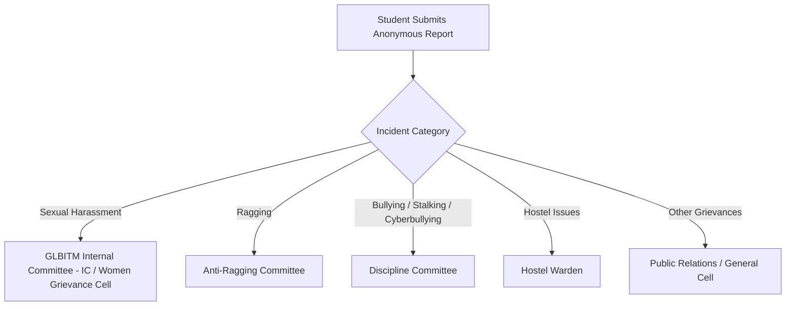

# SafeConnect 🛡️

> **Zero-Knowledge Anonymous College Incident Reporting & Institutional Grievance Redressal System**  
> Tailored for **G.L. Bajaj Institute of Technology and Management (GLBITM), Greater Noida** in full compliance with **AICTE Regulations 2016** and the institute's **Grievance Policy**.

[](https://nextjs.org/)
[](https://www.typescriptlang.org/)
[](https://tailwindcss.com/)
[](https://vitest.dev/)
[](https://www.aicte-india.org/)
[](https://wcd.nic.in/)

---

## 📌 Overview

**SafeConnect** bridges the gap between campus safety and student confidence. Many incidents—especially sexual harassment, ragging, stalking, and cyberbullying—go unreported due to fear of retaliation, social friction, or institutional exposure.

SafeConnect provides a **cryptographically anonymous, zero-PII reporting platform** that routes complaints directly to the appropriate statutory committee at GLBITM, while allowing students to securely track their cases and communicate with authorities via a two-way anonymous chat thread.

---

## 🏛️ Institutional Governance & Compliance (GLBITM)

SafeConnect is built in direct alignment with GLBITM’s approved institutional governance frameworks:

- **Approved BOG Policy**: Grievance Policy approved in the **20th BOG meeting held on 19-05-2018** (Agenda Item No. 20.8).
- **Statutory Mandate**: Prevention, prohibition, and redressal of sexual harassment of women at the workplace as per AICTE Regulations, 2016 vide No. **F.AICTE/WH/2016/01** dated 10th June, 2016.
- **Accreditation & Affiliation**: G.L. Bajaj Institute of Technology & Management, Greater Noida (Approved by AICTE, Affiliated to Dr. A.P.J. Abdul Kalam Technical University, Lucknow, Managed by Rajiv Memorial Academic Welfare Society, Mathura).

### 👥 Reconstituted Internal Committee (IC) / Women Grievance Cell

| S.No. | Name | Designation within Organization | Role within Committee | Category |
| :---: | :--- | :--- | :--- | :--- |
| **1** | **Dr. Rashmi Mishra** | Professor, Deptt. of Applied Science & Humanities | **Presiding Officer** | Head of Committee |
| **2** | **Dr. Nivedita Singh** | Assoc. Professor, Deptt. of MBA | Faculty Member | Faculty |
| **3** | **Dr. Arun Kumar** | Assoc. Professor, Deptt. of Computer Science & Engg. | Faculty Member | Faculty |
| **4** | **Mr. Barun Kumar Singh** | Administrative Officer | Non-Teaching Member | Administration |
| **5** | **Ms. Anjana** | Associate NCC Officer | Non-Teaching Member | NCC / Staff |
| **6** | **Ms. Palak Chadha** | Student, B.Tech. CSE (Roll No. `2401920100223`) | Student Member | Student |
| **7** | **Ms. Palak Tripathi** | Student, MBA (Roll No. `2501920700306`) | Student Member | Student |
| **8** | **Ms. Simran Singh** | Student, MCA (Roll No. `2501920140183`) | Student Member | Student |
| **9** | **Ms. Aayesha Khan** | Sr. Program Manager, Katalyst, Delhi | Member (NGO) | External NGO Representative |

- **Official Email**: [`wgc@glbitm.ac.in`](mailto:wgc@glbitm.ac.in)
- **Meeting Schedule**: General Meeting as per the need.
- **Official Online Grievance System (SIM)**: [https://tinyurl.com/5cpu863a](https://tinyurl.com/5cpu863a)
- **Institutional Grievance Policy (PDF)**: [https://www.glbitm.org/Uploads/2023/Grievance%20Policy.PDF](https://www.glbitm.org/Uploads/2023/Grievance%20Policy.PDF)

---

## 🔒 Core Privacy & Security Guarantees

SafeConnect follows strict **Privacy-by-Design** principles:

1. **Zero Personally Identifiable Information (PII)**:
   - No login, registration, email, phone number, name, or student roll number is ever collected or required from complainants.
   - Zero logging of IP addresses, device user-agents, or browser fingerprints.
2. **Cryptographic Access Tokens**:
   - When a report is submitted, a random 16-character **Access Token** and unique **Case ID** (e.g. `SC-7A3F9`) are generated client-side.
   - Only the cryptographic hash (SHA-256) is stored in Firestore. The raw token is shown **once** to the student and never stored on the server.
   - If the student loses their token, the report cannot be accessed by anyone—enforcing complete mathematical privacy.
3. **Protection Against Victimization (Policy §1.2.7)**:
   - GLBITM policy strictly prohibits retaliation against any individual reporting in good faith. Disciplinary measures are mandated against perpetrators of retaliation.
4. **Statutory Timelines**:
   - **1-Week Meeting Mandate**: The committee convenes within one week of receiving a grievance.
   - **Quorum of 3**: Valid quorum requires at least 3 members physically present; conflict-of-interest recusal is strictly enforced.
   - **14-Day Recommendations**: Formal findings and recommendations are submitted to the Director within 14 days (1 fortnight).

---

## 🧭 Intelligent Departmental Routing

Reports are automatically routed to the responsible college cell based on the category:



---

## ✨ Features

- **Anonymous Incident Reporting (`/report`)**:
  - Multi-step intuitive reporting flow (Category, Description & Location, Optional Evidence, Review).
  - Contextual reassurance banner when "Sexual Harassment" is chosen, highlighting IC jurisdiction and §1.2.7 protection against victimization.
- **Two-Way Anonymous Tracking & Chat (`/track`)**:
  - Students enter Case ID & Access Token to check report progress (`NEW`, `UNDER_REVIEW`, `ACTION_TAKEN`, `CLOSED`).
  - Send and receive follow-up messages with authorities anonymously.
- **GLBITM Women Grievance Cell Directory (`/grievance-cell`)**:
  - Public directory of all 9 committee members with designations, departments, student roll numbers, and NGO affiliation.
  - Plain-language explanation of sexual harassment per Supreme Court Orders.
  - Direct links to official portals, email, and PDF policies.
- **Institutional Grievance Policy Guide (`/grievance-policy`)**:
  - Full interactive breakdown of the 7-page approved BOG policy, statutory committees, evaluation criteria, and redressal workflows.
- **Authority Administration & Developer Panel (`/admin`)**:
  - Case review dashboard, status lifecycle management, internal notes, and tamper-evident audit logging.
  - Complete operations guide & developer emergency playbook: [ADMIN_AND_COMMITTEE_DASHBOARD_GUIDE.md](file:///Users/mohdaltamish/Developer/SafeConnect/safeconnect/ADMIN_AND_COMMITTEE_DASHBOARD_GUIDE.md).

---

## 🛠️ Technology Stack

| Layer | Technology | Purpose |
| :--- | :--- | :--- |
| **Frontend** | [Next.js 14](https://nextjs.org/) (App Router) | Server-rendered & statically generated pages |
| **Language** | [TypeScript](https://www.typescriptlang.org/) | End-to-end type safety |
| **Styling** | [Tailwind CSS](https://tailwindcss.com/) | Custom accessible, trauma-informed color palette |
| **Icons** | [Lucide React](https://lucide.dev/) | Clean, accessible iconography |
| **Database** | [Firebase Cloud Firestore](https://firebase.google.com/docs/firestore) | Secure document storage (server Admin SDK access only) |
| **Serverless** | [Firebase Cloud Functions](https://firebase.google.com/docs/functions) | Background event processing and authority alerts |
| **Testing** | [Vitest](https://vitest.dev/) | High-speed unit & integration testing |

---

## 📂 Project Structure

```
safeconnect/
├── app/
│   ├── (public)/
│   │   ├── page.tsx               # Landing page with GLBITM highlight card
│   │   ├── grievance-cell/        # Women Grievance Cell / IC directory & mandate
│   │   ├── grievance-policy/      # Institutional Grievance Policy guide
│   │   ├── report/                # Multi-step anonymous reporting form
│   │   │   └── success/           # One-time Case ID & Access Token display
│   │   └── track/                 # Case status lookup & anonymous chat
│   │       └── [caseId]/          # Secure case tracking view
│   ├── admin/                     # Authority dashboard & case management
│   ├── api/                       # Zero-knowledge Server API endpoints
│   ├── globals.css                # Custom styling & typography (Inter font)
│   └── layout.tsx                 # Root application layout
├── components/
│   ├── admin/                     # Authority case tables & status dropdowns
│   ├── report/                    # Category selector, step indicator, report form
│   ├── shared/                    # Navbar, Footer, ChatThread, EmptyState
│   └── ui/                        # Accessible Button, Card, Input, Badge components
├── functions/                     # Cloud Functions for event-driven backend tasks
├── lib/
│   ├── auth/                      # SHA-256 access token hashing & verification
│   ├── constants/
│   │   └── glbitm.ts              # Verified IC members, AICTE mandate, policy constants
│   ├── firebase/                  # Firebase Client & Admin SDK initializers
│   ├── routing/
│   │   └── routeReport.ts         # Statutory category-to-department router
│   └── validators/                # Zod schemas for input validation
├── types/
│   └── index.ts                   # Core domain models (Report, Department, Member)
└── __tests__/                     # Automated test suites (Routing, Tokens, GLBITM data)
```

---

## 🚀 Getting Started

### Prerequisites

- **Node.js**: v18.17.0 or later
- **npm** or **pnpm** / **yarn**

### Installation

1. **Clone the repository**:
   ```bash
   git clone https://github.com/MohdAltamish/SafeConnect.git
   cd SafeConnect/safeconnect
   ```

2. **Install dependencies**:
   ```bash
   npm install
   ```

3. **Configure Environment Variables**:
   Copy `.env.local.example` to `.env.local` and add your Firebase credentials:
   ```bash
   cp .env.local.example .env.local
   ```

4. **Run the Development Server**:
   ```bash
   npm run dev
   ```
   Open [http://localhost:3000](http://localhost:3000) in your browser.

---

## 🧪 Testing & Verification

Run the automated test suite powered by Vitest:

```bash
# Run all unit tests
npm test

# Run tests in watch mode
npm run test:watch
```

Run a complete production build to verify static generation and type safety:

```bash
npm run build
```

---

## ⚖️ Legal & Emergency Disclaimer

SafeConnect is an institutional reporting platform and does not replace emergency law enforcement services.

- **National Emergency Number**: `112`
- **National Commission for Women (NCW) Helpline**: `7827170170`
- **Women Helpline (All India)**: `1091`
- **UGC Anti-Ragging Helpline**: `1800-180-5522`
- **GLBITM Women Grievance Cell**: [`wgc@glbitm.ac.in`](mailto:wgc@glbitm.ac.in)

---

## 📄 License

Distributed under the [MIT License](LICENSE). Built for campus safety and student empowerment at **G.L. Bajaj Institute of Technology and Management**.
